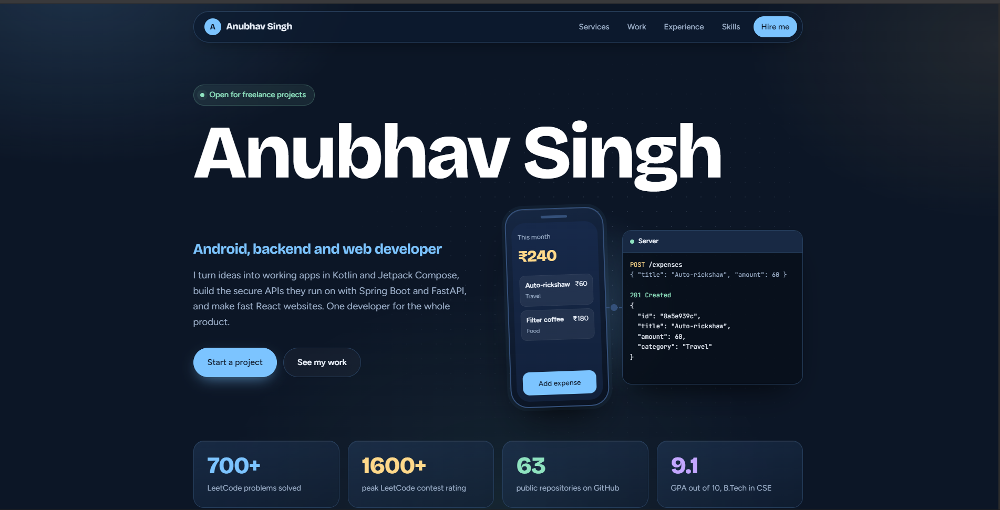

# Anubhav Singh | Developer Portfolio

A responsive portfolio website for a freelance Android, backend and web developer. It presents services, selected projects, work experience and skills, and makes it easy for clients to get in touch.



## Features

- **Interactive hero demo.** A phone mock-up and a server panel work together. Tap "Add expense" and the server panel shows the request and response, which shows how an app and its API fit together.
- **Clear sections.** Services, selected work, more projects, how I work, experience, skills and contact.
- **Responsive design.** Tested from small phones to wide desktop screens.
- **Accessible.** Visible keyboard focus, semantic HTML and support for reduced-motion settings.
- **Easy to edit.** All text and links live in one file, `src/data.js`.
- **Fast and self-contained.** Fonts are bundled with the site, so it needs no external font requests.

## Tech stack

- [React 18](https://react.dev/)
- [Vite 5](https://vite.dev/)
- Plain CSS with custom properties, with no UI framework
- [Fontsource](https://fontsource.org/) for Bricolage Grotesque, Figtree and JetBrains Mono

## Getting started

You need [Node.js](https://nodejs.org/) 18 or newer.

```bash
# Install dependencies
npm install

# Start the dev server (usually http://localhost:5173)
npm run dev
```

## Scripts

| Command           | What it does                                  |
| ----------------- | --------------------------------------------- |
| `npm run dev`     | Starts the development server with hot reload |
| `npm run build`   | Creates a production build in `dist/`         |
| `npm run preview` | Serves the production build locally           |

## Project structure

```
.
├── docs/
│   └── preview.png      Screenshot used in this README
├── src/
│   ├── App.jsx          Page sections and layout
│   ├── LiveDemo.jsx     Interactive phone and server demo
│   ├── data.js          All site content (text, projects, links)
│   ├── styles.css       All styling and colour tokens
│   └── main.jsx         App entry point and font imports
├── index.html           HTML shell and page metadata
├── vite.config.js       Vite configuration
└── package.json
```

## Customising

- **Content:** Edit `src/data.js` to change your name, contact details, services, projects, experience and skills.
- **Colours:** Change the CSS variables at the top of `src/styles.css` (`--bg`, `--sky`, `--butter`, `--mint` and others).
- **Page title and description:** Update the tags in `index.html`.
- **Project links:** Each project in `src/data.js` has an `href`. Add one to the entries in `moreProjects` to link them to their own repositories.

## Deployment

Run `npm run build` and upload the `dist/` folder to any static host. The build uses relative paths, so it works on all of these:

- **Vercel or Netlify:** Import the GitHub repository. The build command is `npm run build` and the output directory is `dist`.
- **Cloudflare Pages:** Use the same build command and output directory.
- **GitHub Pages:** Build locally, then publish the contents of `dist/`, for example with a GitHub Actions workflow or the `gh-pages` package.

## Contact

- Email: thakuranubhav623@gmail.com
- GitHub: [Anubhav8176](https://github.com/Anubhav8176)
- LinkedIn: [Anubhav Singh](https://www.linkedin.com/in/anubhav-singh-133358277/)
- LeetCode: [anubhavsingh08](https://leetcode.com/u/anubhavsingh08/)